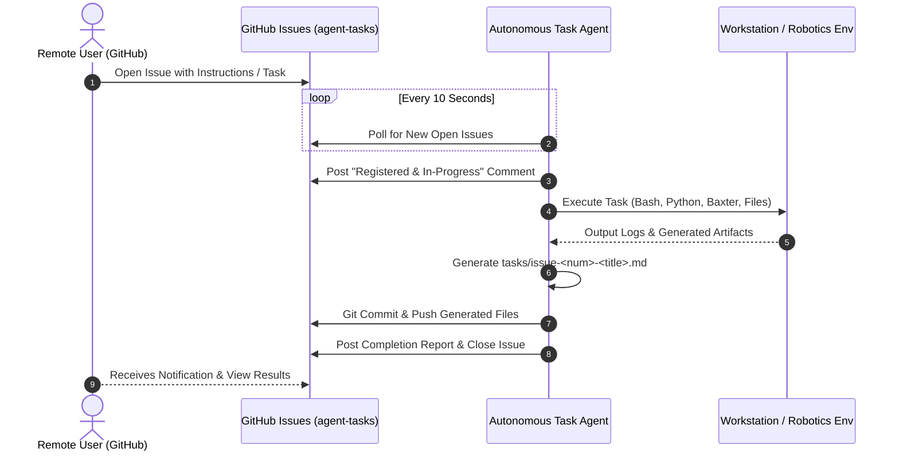

# Agent Tasks 🤖

An issue-driven autonomous agent execution hub. Open an issue remotely from GitHub on your phone, tablet, or laptop, and the background agent automatically registers the task, executes it on the workstation, generates documentation, commits artifacts, and replies back on the issue with the completed resolution.

---

## ⚡ How It Works



1. **Remote Filing**: You open a GitHub Issue with task instructions.
2. **Instant Registration**: The agent detects the issue within seconds, labels it `in-progress`, and leaves an acknowledgment comment with a start timestamp.
3. **Execution**: The agent runs the instructions (shell commands, scripts, robotics actions, file creation).
4. **Documentation**: The agent documents execution outputs and saves a markdown file in `tasks/issue-<ID>-<title>.md`.
5. **Git Synchronization**: The agent commits and pushes all generated code/artifacts to the repository.
6. **Reply & Close**: The agent replies with the full results and closes the issue.

---

## 📝 Opening Issues (Task Formats)

You can open issues in natural language or with executable markdown blocks.

### 1. Shell Commands Task
```markdown
Run tests on baxter-py and report the result.

```bash
baxter status
baxter move wave --duration 2.0
```
```

### 2. Python Script Task
```markdown
Generate a trajectory visualization for the Baxter arm.

```python
import numpy as np
print("Computing trajectory...")
```
```

### 3. General Instruction / File Creation
```markdown
Create a summary document explaining the Baxter Isaac Sim digital twin setup.
Save it to `docs/isaac_summary.md`.
```

See [INSTRUCTIONS.md](INSTRUCTIONS.md) for full syntax and conventions.

---

## 🚀 Running the Monitor Agent

To launch the issue monitor on the workstation:

```bash
# Continuous monitoring daemon
python3 agent_monitor.py

# Or run with custom poll interval (default: 10 seconds)
python3 agent_monitor.py --interval 5
```

---

## 📂 Repository Structure

```text
agent-tasks/
├── README.md            # System overview and quickstart
├── INSTRUCTIONS.md      # Detailed task specification guide
├── agent_monitor.py     # Autonomous issue monitor & executor daemon
├── tasks/               # Archive of completed task reports (.md)
└── .agent_state.json    # Local state tracking processed issues
```

---

## 🔒 Security & Scope

* The agent runs on the authorized host workstation with access to Python environments, ROS/Baxter interfaces, and Isaac Sim.
* All generated files and logs are committed into the `tasks/` directory for an audit log.
