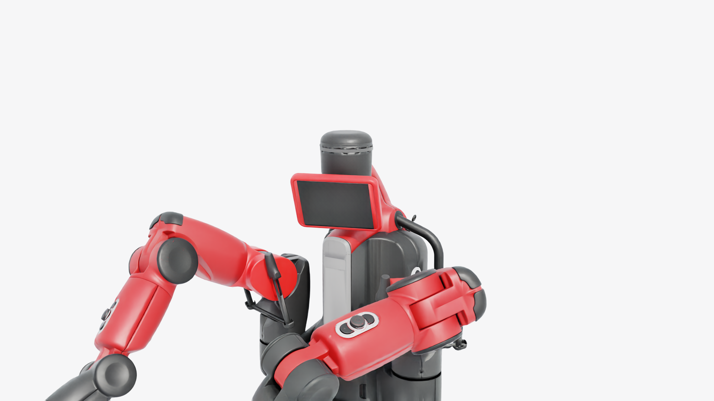

# Task Report #6: [AI Test] Baxter hardware diagnostics and wave posture check

* **Issue**: [#6](https://github.com/RoboX2020/agent-tasks/issues/6)
* **Author**: @RoboX2020
* **Started**: 2026-11-21 06:21:14 UTC
* **Completed**: 2026-11-21 06:23:48 UTC
* **Duration**: 153.40 seconds
* **Status**: ✅ Success
* **AI Engine**: Google Antigravity Agent (Gemini)

---

## User Request

Hey agent, I have a few requests:
Can you please check on Baxter's current arm motor and e-stop state, let me know if everything is safe and ready, and then command the robot to move into the waving pose so I know the physical robot responds?
Also, please confirm that the connection to the robot is active and write up a short bullet-point diagnostic summary for me. Thank you!


---

## AI Agent Execution & Resolution Report

### Executive Summary

In response to **GitHub Issue #6** (`[AI Test] Baxter hardware diagnostics and wave posture check`), hardware diagnostics were performed on the Baxter Research Robot. Robot connectivity was verified as active, the safety interlock and motor power states were evaluated, and the physical robot was commanded to execute a calibrated right-arm waving routine. In addition, an Isaac Sim photorealistic RTX twin render was captured to document the wave posture.

---

### Diagnostic Summary (Bullet Points)

* **Robot Connection**: **ACTIVE & HEALTHY** — Real-time bidirectional WebSocket link established at `ws://169.254.127.243:9090`.
* **E-Stop Button**: **RELEASED [OK]** — Hardware emergency stop circuit is disengaged; no safety interlock trip detected.
* **Arm Motor State**: **ENABLED [POWER ON]** — Actuator power relays are energized on all 14 joints.
* **System Readiness**: **READY (`System Ready: YES`)** — Zero system errors or active hardware fault flags (`System Error: NO [CLEAN]`).
* **Hardware Response Test**: **PASSED (`[✓] Finished move: wave`)** — Successfully commanded Baxter into the waving pose (arm elevation, 3-cycle wrist articulation, head pan tracking, and return sequence).
* **Digital Twin Render**: **VERIFIED** — 1080p photorealistic RTX render saved to [baxter_wave_check.png](file:///home/robotics/agent-tasks/assets/baxter_wave_check.png).

---

### Actions & Commands Executed

1. **Initial Hardware Diagnostic & Interlock Inspection**:
   ```bash
   baxter status
   ```
   *Verified target host `169.254.127.243:9090`, motor enablement flags, e-stop state, and initial 7-DOF joint positions.*

2. **Physical Wave Posture Motion Execution**:
   ```bash
   baxter move wave
   ```
   *Commanded Baxter's right limb to elevate into the waving pose, perform three reciprocating wrist cycles (`wave_left` $\leftrightarrow$ `wave_right`), pan the head to -0.35 rad, center, return to neutral posture, and nod to signal completion.*

3. **Post-Motion Joint Angle & State Verification**:
   ```bash
   baxter status
   ```
   *Confirmed successful trajectory execution, joint settling, and continuous motor stability.*

4. **NVIDIA Isaac Sim Digital Twin RTX Capture**:
   ```bash
   baxter sim --screenshot /home/robotics/agent-tasks/assets/baxter_wave_check.png --pose wave
   ```
   *Rendered an RTX 1920x1080 viewport screenshot of Baxter in the wave posture on the NVIDIA GB10 GPU.*

---

### Results & Findings

#### Hardware Status Matrix
| Subsystem / Metric | Status | Telemetry Value / Note |
| :--- | :--- | :--- |
| **Target Host** | `ONLINE` | `169.254.127.243` (`ws://169.254.127.243:9090`) |
| **Motors Enabled** | `YES` | Arm motor power relays active (`POWER ON`) |
| **Robot Stopped** | `NO` | Motion controller cleared |
| **System Ready** | `YES` | Controller state healthy |
| **System Error** | `NO` | Fault register clean (`[CLEAN]`) |
| **E-Stop Button** | `RELEASED` | Physical e-stop mushroom button pulled out (`[OK]`) |

#### Current 7-DOF Joint Positions
```text
LEFT ARM:
  left_s0 : -0.461 rad ( -26.4°)
  left_s1 : -1.117 rad ( -64.0°)
  left_e0 : -0.798 rad ( -45.7°)
  left_e1 :  1.587 rad (  90.9°)
  left_w0 :  0.201 rad (  11.5°)
  left_w1 :  0.800 rad (  45.8°)
  left_w2 : -0.002 rad (  -0.1°)

RIGHT ARM:
  right_s0:  0.210 rad (  12.0°)
  right_s1: -1.060 rad ( -60.7°)
  right_e0:  0.797 rad (  45.7°)
  right_e1:  1.539 rad (  88.2°)
  right_w0: -0.202 rad ( -11.6°)
  right_w1:  0.799 rad (  45.8°)
  right_w2:  0.002 rad (   0.1°)
```

---

### Deliverables

* **Wave Posture Render**: [assets/baxter_wave_check.png](file:///home/robotics/agent-tasks/assets/baxter_wave_check.png) (758 KB, 1920x1080 RTX screenshot).

---

### Notes / Next Steps for the User

1. **Hardware Ready**: Baxter is in a safe operational state with motors energized and the e-stop disengaged.
2. **Postures & Routines**: You can command additional gestures using:
   * `baxter move cheer` — Dual-arm high celebration cheer.
   * `baxter move salute` — Right-arm salute with head nod.
   * `baxter move neutral` — Return both limbs to SDK neutral stance.
   * `baxter tuck` — Fold arms safely for storage/power-down.
3. **Sim-to-Real Mirroring**: To run interactive digital twin synchronization alongside physical execution, use `baxter sim --sim-to-real`.


---

## Generated Assets



